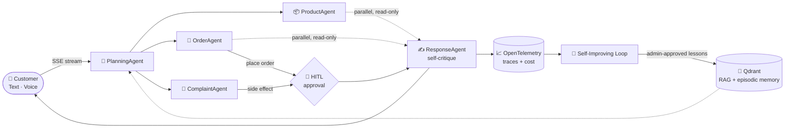

<!-- ===================== HEADER ===================== -->
<p align="center">
  
</p>

<p align="center">
  <a href="https://github.com/ahmettugur">
    
  </a>
</p>

<p align="center">
  
  <a href="https://github.com/ahmettugur?tab=followers"></a>
  <a href="https://github.com/ahmettugur?tab=repositories"></a>
  <!-- <a href="https://www.linkedin.com/in/YOUR-HANDLE"></a> -->
  <!-- <a href="https://medium.com/@YOUR-HANDLE"></a> -->
</p>

---

## 🧭 About me

```csharp
public sealed record Developer
{
    public string Name      => "Ahmet Tügür";
    public string Role      => "Senior .NET Developer";
    public string[] Focus   => ["Multi-Agent AI Systems", "Distributed Architecture", "Observability"];

    public string[] Patterns => [
        "Clean / Hexagonal / Onion Architecture", "DDD", "CQRS", "Event Sourcing",
        "ReAct + Self-Reflection", "Human-in-the-Loop", "RAG & Semantic Memory"
    ];

    public string[] Stack   => ["C#", ".NET 10", "Microsoft Agent Framework", "Semantic Kernel",
                                "Kafka", "RabbitMQ", "PostgreSQL", "Qdrant", "Docker", "Kubernetes"];

    public string Belief    => "An LLM is just another adapter — the architecture still matters.";
}
```

- 🤖 Currently building **production-grade agentic systems**: specialized agents, orchestration, tool routing, HITL approval gates and self-improving feedback loops
- 🏗️ Long-time practitioner of **Clean / Hexagonal Architecture, DDD, CQRS and Event Sourcing** — in both **.NET** and **Spring Boot**
- 🔭 Observability-first: every agent step, LLM call and tool invocation is traced with **OpenTelemetry**
- 🎓 Mentor to interns and junior developers — I write training material on architecture and agentic AI

---

## 🌟 Flagship: Agentic Customer Support Bot

> A multi-agent customer support system built with **Microsoft Agent Framework (MAF)** on **.NET 10**, structured as **Hexagonal Architecture** (Domain · Application · Adapters).



<table>
<tr>
<td width="50%" valign="top">

**🧠 Reasoning & Control**
- Structured reasoning — `preToolCheck` / `postToolReflection` (ReAct + Self-Reflection)
- Human-in-the-Loop gates for side-effecting actions
- Parallel sub-task execution for compound queries (`Task.WhenAll`)
- SLA Guardian: auto-reject stale approvals, auto-escalate priority

</td>
<td width="50%" valign="top">

**📚 Memory & Learning**
- Semantic memory + RAG on **Qdrant**, plus episodic memory
- Per-customer personalization profile injected via a context pipeline
- Self-improving loop: low-rated traces → LLM-generated lessons → knowledge base
- Skills-based smart routing for human escalation

</td>
</tr>
<tr>
<td width="50%" valign="top">

**🎤 Realtime Voice (dual mode)**
- *Bridge mode*: voice in/out over the full 6-agent pipeline, HITL intact
- *Native mode*: model-side function calling on read-only tools — ~3–5× faster

</td>
<td width="50%" valign="top">

**🔭 Operability**
- OTLP traces & metrics → Jaeger / Prometheus / Grafana
- Per-model USD cost & token accounting
- Trace Replay UI to step through any workflow run

</td>
</tr>
</table>

<p align="center">
  <a href="https://github.com/ahmettugur/agentic-customer-support-bot"><b>→ Explore the repository</b></a>
</p>

---

## 🚀 Featured projects

### 🤖 AI & Agents

<p align="center">
  <a href="https://github.com/ahmettugur/agentic-customer-support-bot"></a>
  <a href="https://github.com/ahmettugur/enterprise-ai-assistant"></a>
</p>

| Project | Highlights | Stack |
|---|---|---|
| [**agentic-customer-support-bot**](https://github.com/ahmettugur/agentic-customer-support-bot) | 6-agent MAF pipeline, HITL, RAG + episodic memory, self-improving loop, realtime voice, trace replay | `.NET 10` `MAF` `Blazor WASM` `PostgreSQL` `Qdrant` `OpenTelemetry` |
| [**enterprise-ai-assistant**](https://github.com/ahmettugur/enterprise-ai-assistant) | AI assistant for business intelligence: intent routing to Chat / Document / Report agents, **natural-language → SQL** reports, document RAG, scheduled jobs | `.NET 10` `Semantic Kernel` `Angular` `SignalR` `Neo4j` `Qdrant` `DuckDB` `Hangfire` |

### 🏛️ Architecture & Distributed Systems

<p align="center">
  <a href="https://github.com/ahmettugur/MinimalApiCleanArchitecture"></a>
  <a href="https://github.com/ahmettugur/CQRS-EventSourcing"></a>
</p>

| Project | Highlights | Stack |
|---|---|---|
| [**MinimalApiCleanArchitecture**](https://github.com/ahmettugur/MinimalApiCleanArchitecture) | Minimal API + gRPC on Onion Architecture; centralized logging, distributed tracing, service discovery, k8s deployment, SonarCloud quality gates | `.NET 8` `gRPC` `Serilog` `ELK` `RabbitMQ` `Jaeger` `Zipkin` `Consul` |
| [**CQRS-EventSourcing**](https://github.com/ahmettugur/CQRS-EventSourcing) | Banking account domain with separate command/query APIs and a **pluggable broker** (Kafka or RabbitMQ) | `.NET 8` `Kafka` `RabbitMQ` `MongoDB` `SQL Server` |
| [**SpringBoot-CQRS-EventSourcing**](https://github.com/ahmettugur/SpringBoot-CQRS-EventSourcing) | The same CQRS + ES ideas on the JVM — reusable `cqrs-es` core, command / query services | `Spring Boot` `Kafka` `MongoDB` `MySQL` `PostgreSQL` |
| [**AspNetAspireMicroservice**](https://github.com/ahmettugur/AspNetAspireMicroservice) | Cloud-native microservices orchestrated by **.NET Aspire** with built-in tracing, structured logs and dashboard | `.NET 9` `Aspire` `EF Core` `PostgreSQL` `RabbitMQ` `OpenTelemetry` |

### ☁️ Cloud Native & DevOps

| Project | Highlights | Stack |
|---|---|---|
| [**devops-shopping**](https://github.com/ahmettugur/devops-shopping) | .NET microservices deployed to **Azure Kubernetes Service** with automated Azure Pipelines | `AKS` `Azure DevOps` `Docker` `k8s` |
| [**ProductsStoreOnKubernetes**](https://github.com/ahmettugur/ProductsStoreOnKubernetes) | ASP.NET MVC + SQL Server on Kubernetes with Helm charts, local & Azure manifests | `Kubernetes` `Helm` `SQL Server` `Azure` |

<details>
<summary><b>🧰 More: Go, full-stack samples & case studies</b></summary>
<br/>

| Project | Description |
|---|---|
| [**toolkit**](https://github.com/ahmettugur/toolkit) | Reusable Go module — JSON I/O, file upload/download, slugs, random strings (`go get github.com/ahmettugur/toolkit`) |
| [**TechCase**](https://github.com/ahmettugur/TechCase) | Add-to-cart technical case with Redis, SQL Server, Docker and tests |
| [**dotnet-core-webapi**](https://github.com/ahmettugur/dotnet-core-webapi) | ASP.NET Core Web API sample |
| [**react-redux-aspnet-core-webapi**](https://github.com/ahmettugur/react-redux-aspnet-core-webapi) · [**react-redux-golang-webapi**](https://github.com/ahmettugur/react-redux-golang-webapi) · [**react-redux-nodejs-webapi**](https://github.com/ahmettugur/react-redux-nodejs-webapi) | Same React + Redux frontend against three different backends — .NET, Go and Node.js |

</details>

---

## 🛠️ Tech stack

<p align="center"><b>Languages & Frameworks</b><br/><br/>
  
</p>

<p align="center"><b>Data, Messaging & Search</b><br/><br/>
  
</p>

<p align="center"><b>Cloud, DevOps & Observability</b><br/><br/>
  
</p>

<p align="center"><b>AI & Agents</b><br/><br/>
  
  
  
  
  
  
  
  
</p>

<details>
<summary><b>🧩 Architecture & patterns I work with</b></summary>
<br/>

| Area | Patterns & practices |
|---|---|
| **Application architecture** | Clean · Hexagonal (Ports & Adapters) · Onion · Modular Monolith · Vertical Slices |
| **Domain** | DDD (aggregates, domain events, bounded contexts) |
| **Distributed systems** | CQRS · Event Sourcing · Outbox · Saga · Service Discovery · gRPC |
| **Agentic AI** | Planner / specialist / responder topology · ReAct · Self-Reflection · HITL · RAG · Episodic memory · Tool routing |
| **Observability** | OpenTelemetry traces & metrics · Jaeger / Zipkin · Serilog + ELK · LLM cost telemetry |
| **Delivery** | Docker · Kubernetes · Helm · Azure DevOps · .NET Aspire · SonarCloud |

</details>

---

## 📊 GitHub activity

<p align="center">
  
  
</p>

<p align="center">
  
</p>

<p align="center">
  
</p>

<p align="center">
  
</p>

---

<p align="center">
  <i>"Architecture is about the important stuff — whatever that is."</i> — Ralph Johnson
</p>

<!-- ===================== FOOTER ===================== -->
<p align="center">
  
</p>
